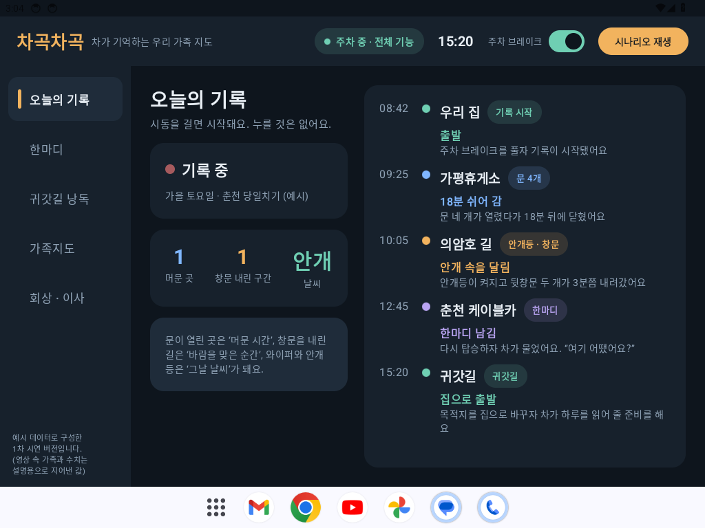
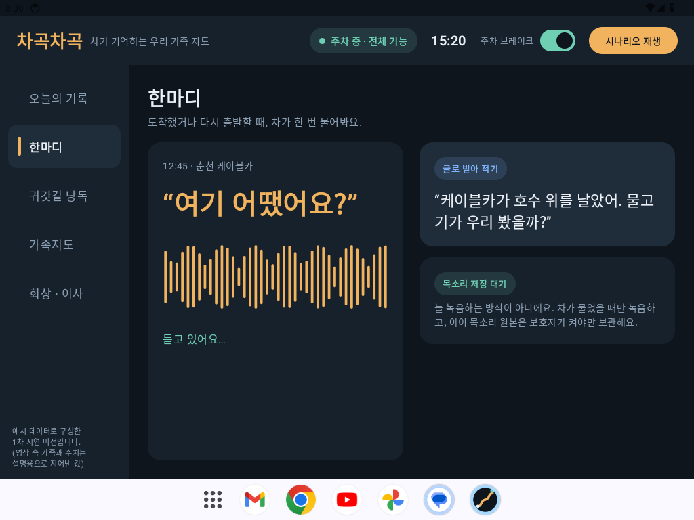
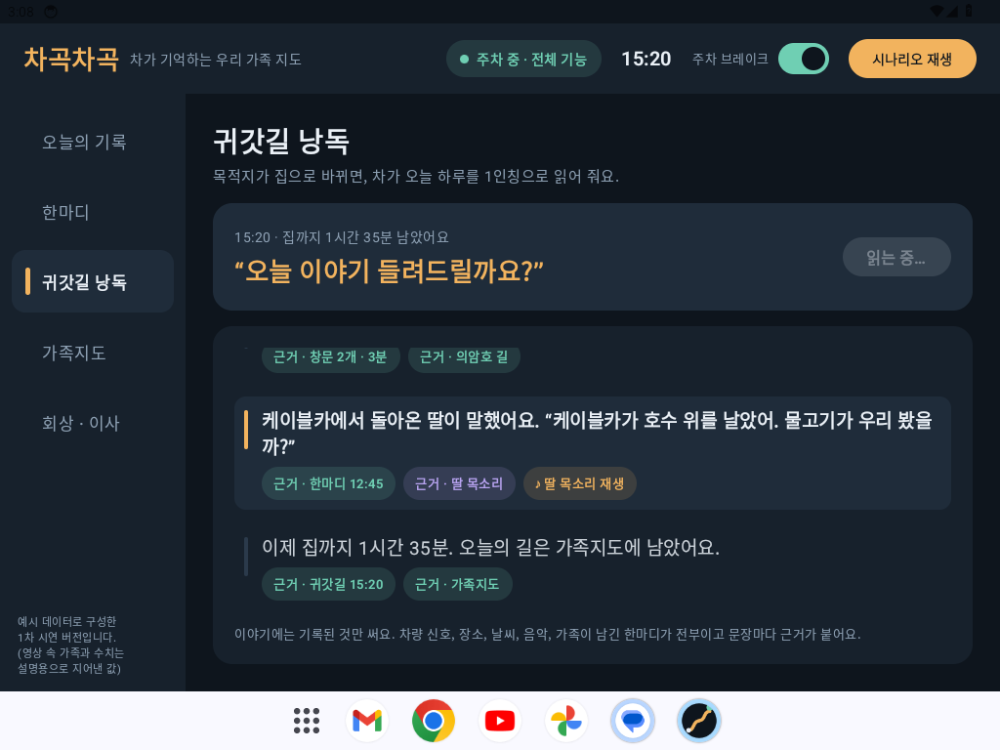
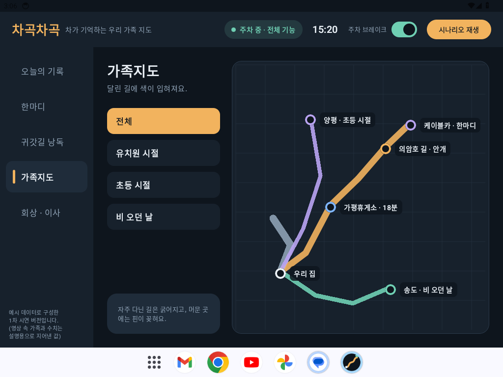
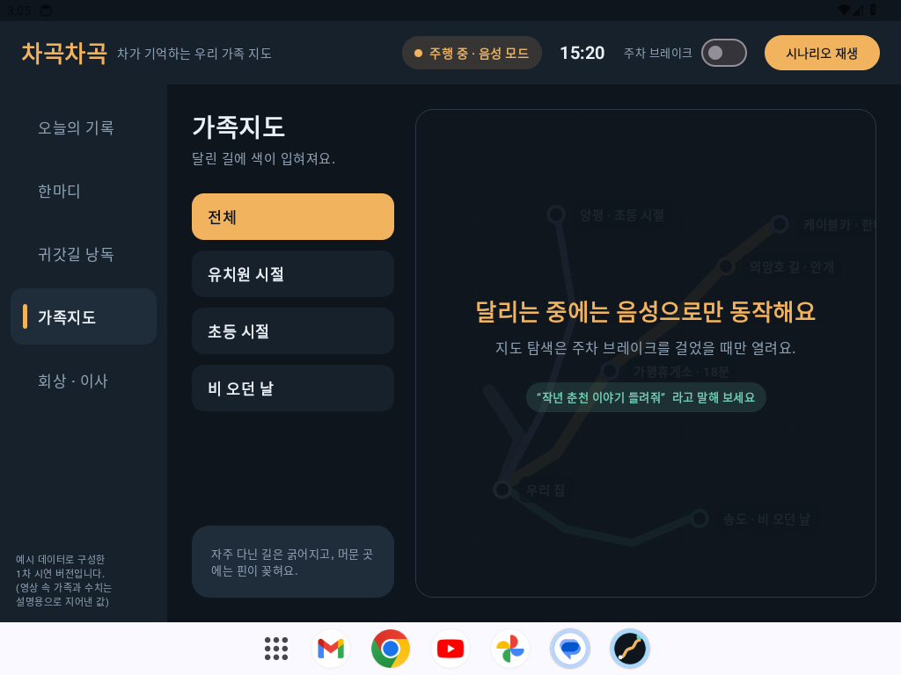
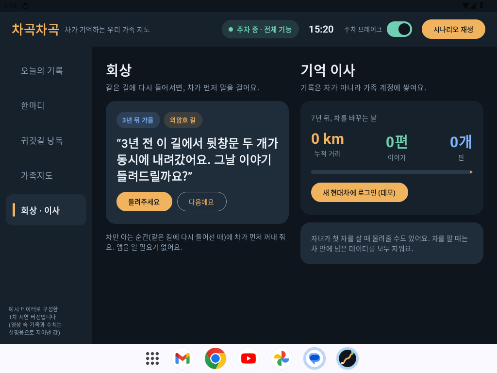

# 차곡차곡

> 문이 열린 곳과 창문을 내린 길까지 차가 알아서 적어 두고, 달린 길마다 우리 가족 이야기를 쌓아 주는 가족 지도 앱

현대자동차그룹 차량용 앱 개발 공모전 · 팀 **하윤이** · **1차 제출 버전 (v0.1.0, 화면 시연용 프로토타입)**

## 이 버전은 무엇인가

접수양식 4장의 "가을 토요일 춘천 당일치기" 시나리오를 **미리 넣어 둔 예시 데이터**로 재생하는 화면 프로토타입입니다.
실제 차량 신호, 서버, 로그인은 아직 연결하지 않았습니다. (영상·앱 속 가족과 수치는 설명을 위해 지어낸 예시입니다.)

| 화면 | 보여주는 것 | 기획서 기능 |
|---|---|---|
| 오늘의 기록 | 시동~귀갓길까지 문·창문·안개등 이벤트가 타임라인으로 쌓임 | ① 자동 기록 |
| 한마디 | 차가 “여기 어땠어요?” 하고 묻고, 아이 대답이 글·목소리로 남음 | ② 한마디 |
| 귀갓길 낭독 | 하루를 1인칭 이야기로 읽어 주고 문장마다 근거 표시 | ③ 귀갓길 낭독, ④ 장소 감성 |
| 가족지도 | 달린 길 색칠, 핀, 시절·날씨 필터. **주행 중에는 잠기고 주차 중에만 열림** | ⑤ 가족지도 |
| 회상 · 이사 | 같은 길에 다시 들어서면 차가 먼저 말을 걺, 새 차로 기록 이사 | ⑥ 회상, ⑦ 기억 이사 |

상단의 **주차 브레이크** 스위치로 주행/주차 상태를 바꿀 수 있고, **시나리오 재생** 버튼을 누르면 하루가 시간 순서대로 쌓입니다.

## 실행 방법

### APK 설치

`apk/하윤이_차곡차곡_release.apk` 를 설치합니다.

```bash
adb install apk/하윤이_차곡차곡_release.apk
```

설치 후 “차곡차곡” 앱을 실행하면 됩니다. 가로 화면 전용입니다.

### 소스에서 빌드

```bash
./gradlew assembleRelease     # release 서명 키가 없으면 서명되지 않은 APK가 만들어집니다
./gradlew assembleDebug       # 키 없이 바로 실행해 볼 수 있는 debug 빌드
./gradlew installDebug        # 연결된 에뮬레이터/기기에 설치
```

release 서명 정보는 저장소에 올리지 않는 `keystore.properties` 로 읽습니다. (없으면 debug 빌드를 사용하세요.)

## 테스트 환경 및 필요한 설정

- Android Studio 최신 버전 또는 JDK 17 + Android SDK (compileSdk 35)
- Gradle 8.10.2 (wrapper 포함), Android Gradle Plugin 8.8.2, Kotlin 2.0.0, Jetpack Compose (BOM 2024.10.01)
- minSdk 28 / targetSdk 35
- 1차 버전은 Pleos SDK 없이 동작하며, 별도의 API 키·계정·네트워크가 필요하지 않습니다.

## 개발에 사용한 Pleos Connect 에뮬레이터 버전과 화면 규격

- 개발 대상: **Pleos Connect Emulator 2.1.0** (Automotive, Android 14 / API 34, 가로형 화면)
- 검증 현황: Android Emulator(API 34, `google_apis` x86_64, 하드웨어 프로필 `automotive_1024p_landscape`)에서 release APK 설치·실행·5개 화면 동작을 확인했습니다. **Pleos Connect Emulator 2.1.0 시스템 이미지에서는 아직 실행해 보지 못했습니다.** (Pleos 이미지 검증은 PT 전 개발 단계에서 진행 예정)
- 화면 규격: 검증에 사용한 화면은 **1024 x 768 px, 160 dpi, 가로(landscape)** 입니다. (`adb shell wm size`, `adb shell wm density` 기준) Pleos Connect Emulator의 FormFactorConsole 디스플레이 프리셋(12.9인치 세로 / 14.6인치 가로 등)에서의 확인은 2차에서 진행합니다. 앱은 가로 전용이며 `sensorLandscape`로 고정됩니다.

## 화면

| 오늘의 기록 | 한마디 | 귀갓길 낭독 |
|---|---|---|
|  |  |  |

| 가족지도 | 주행 중 잠금 | 회상 · 이사 |
|---|---|---|
|  |  |  |

## APK 위치

- `apk/하윤이_차곡차곡_release.apk` (release 서명 빌드)

## 앞으로 (PT 전까지)

- Pleos Vehicle SDK(Door, Window, Wiper, Light 등) · NaviHelper 연동으로 실제 신호 기록
- 이야기 생성과 근거 검증, 음성 입출력(SpeechToText/TextToSpeech) 연동
- 가족 계정 동기화와 기억 이사

## 구조

```
app/src/main/java/kr/hayuni/chagokchagok/
├─ data/Scenario.kt      # 시나리오 예시 데이터 (추후 Vehicle SDK 공급자로 교체)
├─ ui/ChagokApp.kt       # 상단바, 내비게이션, 시나리오 재생
├─ ui/Screens.kt         # 5개 화면
└─ MainActivity.kt
```
