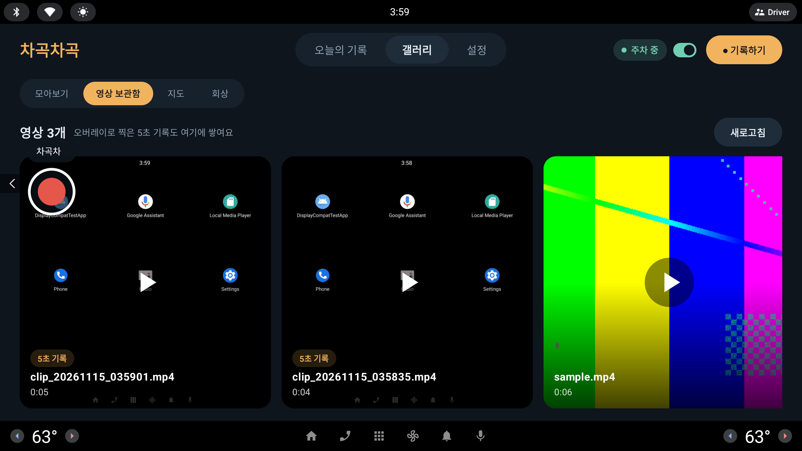
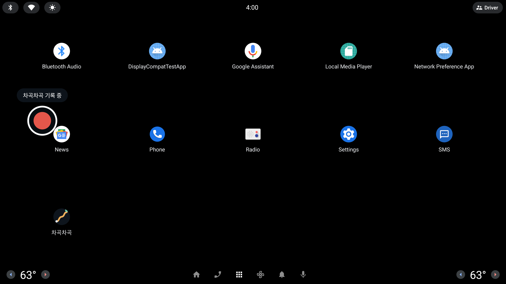
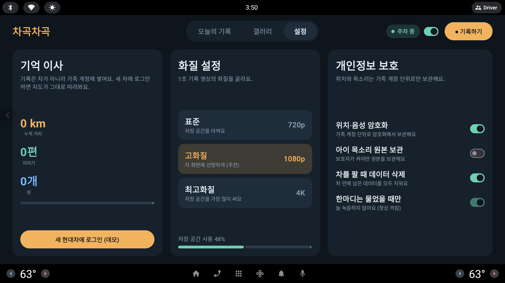

# 차곡차곡

> 문이 열린 곳과 창문을 내린 길까지 차가 알아서 적어 두고, 달린 길마다 우리 가족 이야기를 쌓아 주는 가족 지도 앱

현대자동차그룹 차량용 앱 개발 공모전 · 팀 **하윤이** · **1차 제출 버전 (v0.2.0, 비주얼 프로토타입)**

## 이 버전은 무엇인가

접수양식 4장의 "가을 토요일 춘천 당일치기" 시나리오를 **예시 데이터**로 보여 주는 화면 프로토타입입니다.
실제 차량 신호(Pleos Vehicle SDK)와 서버, 로그인은 아직 연결하지 않았습니다. 앱 속 가족과 수치는 설명을 위해 지어낸 예시이고, 장면 이미지는 코드로 그린 일러스트입니다.

### 사용 흐름

```
시작 화면 ─(차곡차곡 쌓으러 가기)→ 카메라 ─(셔터)→ 오늘의 기록 ─ 상단 탭 → 갤러리 / 설정
```

| 화면 | 내용 |
|---|---|
| 시작 | 기록 이미지를 배경으로, 흰 슬로건과 시작 버튼 |
| 카메라 | 앞유리 풍경 위에 차가 보고 있는 신호(문·창문·안개등·와이퍼·위치)와 셔터. 셔터를 누르면 오늘의 기록이 시작됨 |
| 오늘의 기록 | **오늘 기록**(출발~귀갓길이 1초 클립 카드로 쌓임) · **한마디**(차가 묻고 아이가 대답) · **귀갓길 낭독**(한 문장씩 크게, 문장마다 근거) |
| 갤러리 | **모아보기**(자유 배치 콜라주, 탭하면 타임스탬프·글귀·삭제 편집) · **영상 보관함** · **지도**(주행 중에는 잠기고 주차 중에만 열림) · **회상** |
| 설정 | **기억 이사** · **화질 설정** · **개인정보 보호** |

### 다른 앱과 함께 기록 (오버레이)

카메라 화면의 **"다른 앱과 함께 기록"** 을 누르면(처음 한 번 "다른 앱 위에 표시" 권한 필요, 이어서 화면 녹화 동의) 앱이 뒤로 가고, 다른 앱 위에 **"차곡차곡 기록 중" 동그라미**가 떠 있습니다.
동그라미를 누르면 **지금 화면이 5초 동안 동영상으로 저장**되어 갤러리의 **영상 보관함**에 쌓입니다. (소리는 아직 넣지 않았습니다. 동그라미는 끌어서 옮길 수 있고, 알림의 "중지"로 끝낼 수 있습니다.)

### 영상 보관함 (동영상 저장소)

앱 전용 Movies 폴더(`Android/data/kr.hayuni.chagokchagok/files/Movies`)에 mp4를 넣으면 영상 보관함에 썸네일·길이와 함께 나타나고 탭하면 재생됩니다.
파일 이름을 `road.mp4`로 하면 카메라 화면의 배경으로 반복 재생됩니다. (시연에는 저작권 프리 도로 영상을 사용할 예정)

## 화면

| 시작 | 카메라 | 오늘의 기록 |
|---|---|---|
|  |  |  |

| 갤러리 | 갤러리 편집 | 영상 보관함 |
|---|---|---|
|  |  |  |

| 다른 앱 위의 기록 동그라미 | 설정 |
|---|---|
|  |  |

## 실행 방법

### APK 설치

`apk/하윤이_차곡차곡_release.apk` 를 설치합니다.

```bash
adb install apk/하윤이_차곡차곡_release.apk
```

설치 후 "차곡차곡" 앱을 실행합니다. 가로 화면 전용입니다.
(오버레이 기능은 권한이 필요합니다. 에뮬레이터에서는 `adb shell appops set --user <사용자> kr.hayuni.chagokchagok SYSTEM_ALERT_WINDOW allow` 로 미리 허용할 수 있습니다.)

### 소스에서 빌드

```bash
./gradlew assembleDebug       # 키 없이 바로 실행해 볼 수 있는 debug 빌드
./gradlew installDebug        # 연결된 에뮬레이터/기기에 설치
./gradlew assembleRelease     # release 서명 정보(keystore.properties)가 있어야 서명됨
```

release 서명 정보는 저장소에 올리지 않는 `keystore.properties` 로 읽습니다. (없으면 debug 빌드를 사용하세요.)

## 테스트 환경 및 필요한 설정

- Android Studio 최신 버전 또는 JDK 17 + Android SDK (compileSdk 35)
- Gradle 8.10.2 (wrapper 포함), Android Gradle Plugin 8.8.2, Kotlin 2.0.0, Jetpack Compose (BOM 2024.10.01)
- minSdk 28 / targetSdk 35
- Pleos SDK 없이 동작하며, API 키·계정·네트워크가 필요하지 않습니다.
- 필요 권한: 다른 앱 위에 표시(`SYSTEM_ALERT_WINDOW`), 포그라운드 서비스(화면 녹화), 알림

## 개발에 사용한 Pleos Connect 에뮬레이터 버전과 화면 규격

- 개발 대상: **Pleos Connect Emulator 2.1.0** (Automotive, Android 14 / API 34, 가로형 화면)
- 검증 현황: **Pleos Connect v2.1.0 AVD(Android 14 / API 34, x86_64, `Car on x86_64 emulator`)에서 설치·실행을 확인했습니다.** 시작→카메라→오늘의 기록, 갤러리 편집, 영상 보관함 재생, 오버레이 동그라미와 5초 화면 녹화까지 동작했습니다.
- 화면 규격: Pleos Connect AVD 기본 디스플레이 **2560 x 1440 px, 160 dpi, 가로(landscape)** (`adb shell wm size`, `adb shell wm density` 기준, 약 1600 x 900 dp). 앱은 가로 전용(`sensorLandscape`)입니다. FormFactorConsole의 다른 디스플레이 프리셋(12.9인치 세로 등)은 아직 확인하지 않았습니다.
- 알려진 점: 차량 에뮬레이터는 다중 사용자(앱은 user 10 실행)라 영상 파일을 `adb push`로 앱 저장소에 넣을 수 없어, 앱이 앱 내부 폴더(`files/movies`)도 함께 읽습니다.

## APK 위치

- `apk/하윤이_차곡차곡_release.apk` (release 서명 빌드)

## 앞으로 (PT 전까지)

- Pleos Vehicle SDK(Door, Window, Wiper, Light 등) · NaviHelper 연동으로 실제 신호 기록
- 이야기 생성과 근거 검증, 음성 입출력(SpeechToText/TextToSpeech) 연동
- 가족 계정 동기화와 기억 이사, 오버레이 기록의 소리(유지/삭제 결정)

## 구조

```
app/src/main/java/kr/hayuni/chagokchagok/
├─ MainActivity.kt        # 화면 녹화 동의, 오버레이 시작
├─ OverlayService.kt      # 다른 앱 위의 기록 동그라미 + 5초 화면 녹화
├─ data/Scenario.kt       # 시나리오·문구·갤러리 카드·색 (추후 Vehicle SDK 공급자로 교체)
├─ data/VideoStore.kt     # 영상 보관 폴더
└─ ui/                    # ChagokApp, StartCamera, Today, Gallery, GalleryEdit, Settings, Art, Common
```
