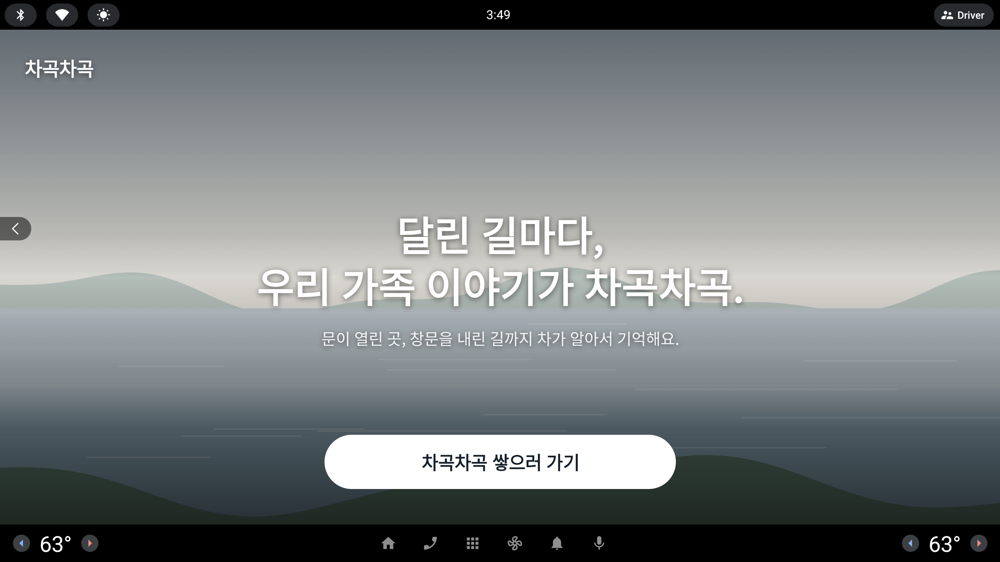
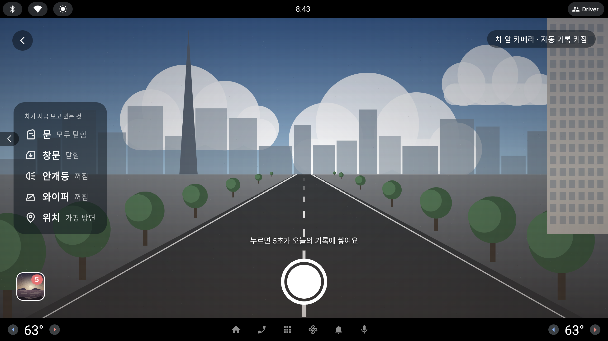
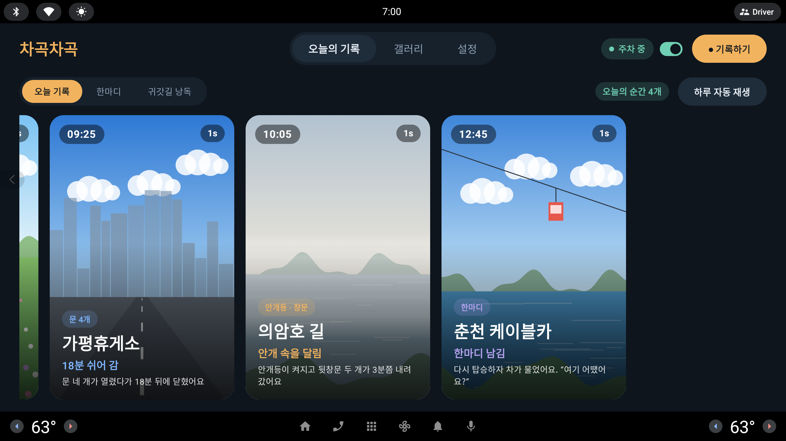
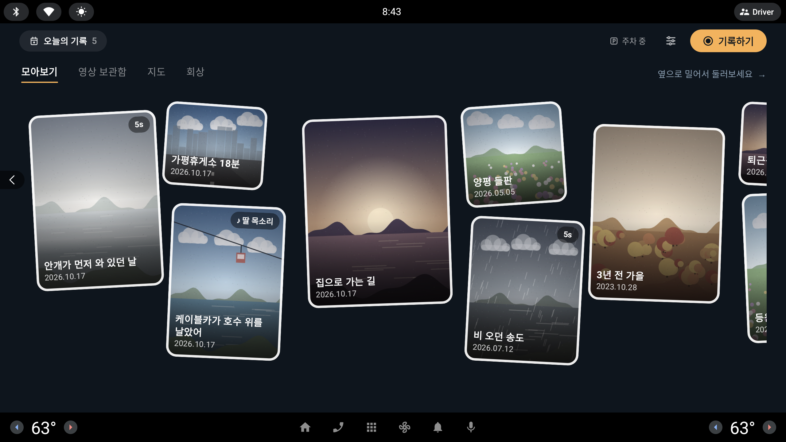
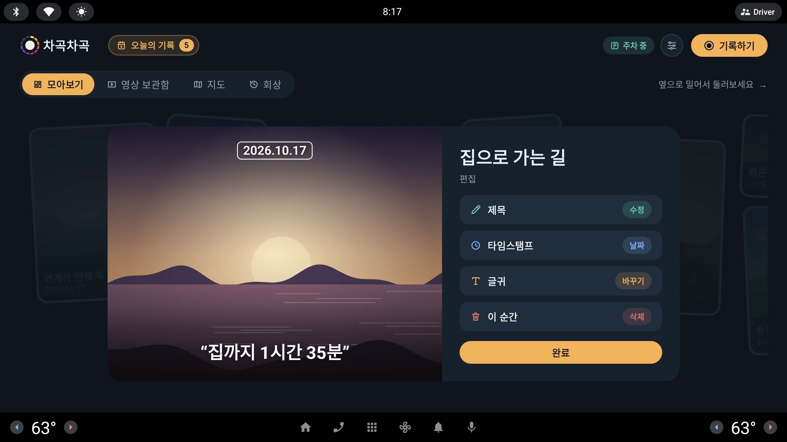
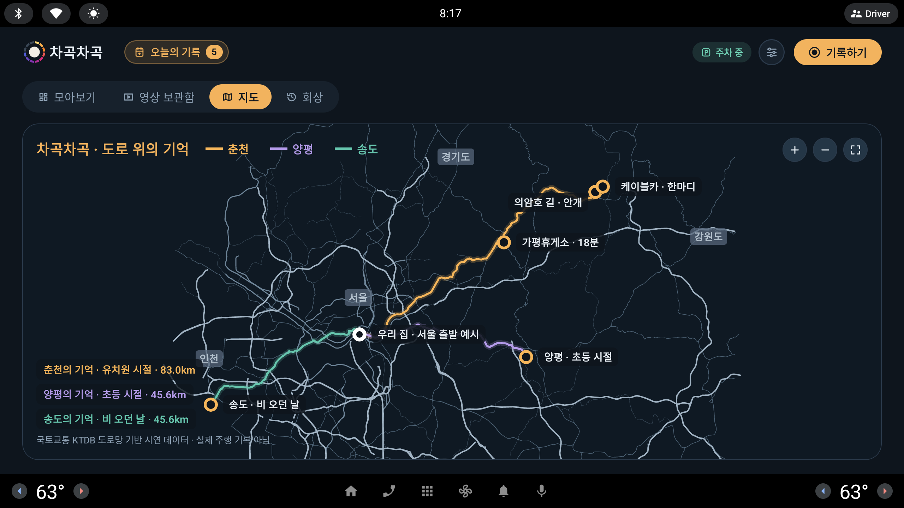
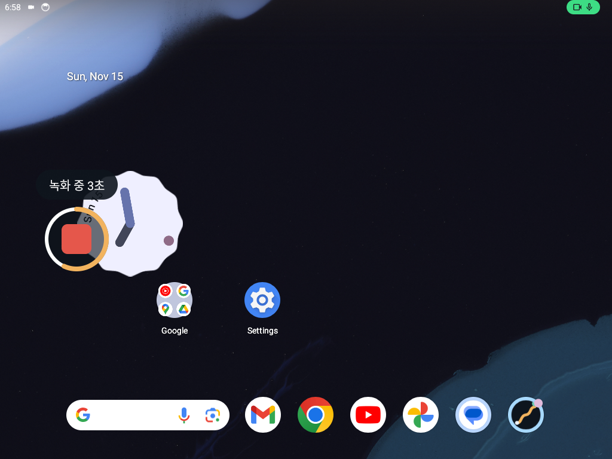

# 차곡차곡

> 문이 열린 곳과 창문을 내린 길까지 차가 알아서 적어 두고, 달린 길마다 우리 가족 이야기를 쌓아 주는 가족 지도 앱

현대자동차그룹 차량용 앱 개발 공모전 · 팀 **하윤이** · **1차 제출 버전 (v0.3.5, 비주얼 프로토타입)**

## 이 버전은 무엇인가

접수양식 4장의 "가을 토요일 춘천 당일치기" 시나리오를 **예시 데이터**로 보여 주는 화면 프로토타입입니다.
실제 차량 신호(Pleos Vehicle SDK)와 서버, 로그인은 아직 연결하지 않았습니다. 앱 속 가족과 수치는 설명을 위해 지어낸 예시이고, 장면 이미지·영상은 AI로 만든 실사풍 자료이며 실제 장소를 정확히 기록한 사진이 아닙니다(가평휴게소만 직접 찍은 사진). 에뮬레이터에는 카메라가 없어 카메라 화면은 도로 사진으로 대신합니다.

### 데모 시나리오 (기본 상태)

앱은 **"춘천 당일치기를 마치고 귀가 중(15:20)"** 인 상황으로 시작합니다. 그래서 오늘의 기록에 하루치 5개(출발 · 가평휴게소 · 의암호 길 · 케이블카 한마디 · 귀갓길)가 이미 쌓여 있고, 한마디와 귀갓길 낭독을 바로 볼 수 있습니다.
설정 맨 아래의 **"목업 환경으로 되돌리기"** 로 언제든 이 기본 상태(시작 화면)로 돌아갑니다.

### 사용 흐름

```
시작 화면 ─(차곡차곡 쌓으러 가기)→ 카메라 ─(셔터 · 화면은 그대로)→ 오늘의 기록이 한 칸씩 쌓임
                                      └ 썸네일/기록하기 → 메인 3탭: 오늘의 기록 / 갤러리 / 설정
```

| 화면 | 내용 |
|---|---|
| 시작 | 기록 이미지를 배경으로, 흰 슬로건과 시작 버튼 |
| 카메라 | 앞유리 풍경 위에 차가 보고 있는 신호(문·창문·안개등·와이퍼·위치)와 셔터. **촬영해도 화면이 넘어가지 않고** "오늘의 기록 N번째 순간이 저장됐어요 ✓"만 뜸. 왼쪽 아래 썸네일(개수 표시)을 누르면 오늘의 기록으로 이동 |
| 오늘의 기록 | **오늘 기록**(1초 클립 카드. 촬영하면 한 칸 추가, 카드를 누르면 **다시보기 · 제목 수정 · 삭제**, "하루 자동 재생") · **한마디**(차가 묻고 아이가 대답) · **귀갓길 낭독**(한 문장씩 크게, 문장마다 근거). 기록이 하나도 없으면 "오늘 기록"만 보임 |
| 갤러리 | **모아보기**(자유 배치 콜라주, 탭하면 타임스탬프·글귀·삭제 편집) · **영상 보관함** · **지도**(도로망 위의 기억, 주행 중에는 잠김) · **회상** |
| 설정 | **기억 이사** · **화질 설정** · **개인정보 보호** · **목업 환경으로 되돌리기** |

### 지도 (도로망 위의 기억)

서울·인천·경기·춘천 주변 **도로망 데이터(국토교통 KTDB 2022 도로 링크 기반, 약 17,750개 도로)** 위에 가족의 기억 경로 3개(춘천·양평·송도)와 장소 핀을 얹었습니다.
두 손가락 확대/이동, **확대 + / 축소 − / 전체** 버튼, 범례(춘천·양평·송도)를 눌러 경로 켜고 끄기, 길이 그려지는 애니메이션을 지원합니다. 경로는 시연용(실제 주행 기록·내비게이션 아님)입니다.
데이터는 `app/src/main/assets/roadmap.bin`(도로) + `roadmap_meta.json`(경로·장소)이며 원본 geojson에서 변환했습니다.

### 홈에서도 살아 있는 기록 버튼 (오버레이: 카메라 + 소리)

앱을 켜 두면(권한이 있을 때) **앱에서 홈으로 나가거나 다른 앱을 열어도 화면 위에 "눌러서 5초 기록" 동그라미가 계속 떠 있습니다.** 노래를 고르다가도 이 버튼만 누르면 바로 **카메라 영상과 차 안의 소리(마이크)가 5초 동안 mp4로 저장**되어 **오늘의 기록에 새 카드로 쌓이고**(카드를 누르면 그 영상이 소리와 함께 재생, 제목 수정·삭제 가능) 갤러리의 **영상 보관함**에도 보입니다. (확인: H.264 1280×720 영상 + AAC 소리)
- 차곡차곡 앱 화면이 보이는 동안에는 숨고(앱 안에 촬영 버튼이 있음), 앱에서 나가면 다시 나타납니다.
- 처음 한 번 **"다른 앱 위에 표시"·카메라·마이크 권한**이 필요합니다. ("차곡차곡 쌓으러 가기"를 누를 때 요청)
- **설정 > 화질 설정 > "홈에서도 기록 버튼 유지"** 스위치나 알림의 **"끄기"** 로 끌 수 있습니다.
- 카메라가 없는 기기(Pleos 에뮬레이터 등)에서는 **카메라 대신 앞유리 풍경(흐르는 도로) 화면을 영상으로 기록**하고 마이크 소리를 함께 담아 똑같이 mp4로 저장합니다.
- 소리 포함 여부는 `OverlayService.RECORD_WITH_SOUND` 한 줄로 켜고 끌 수 있습니다. (이후 유지/삭제 결정)
- 동그라미는 끌어서 옮길 수 있습니다. 설정 앱처럼 다른 앱의 오버레이를 숨기는 보안 화면에서는 가려질 수 있습니다.

### 영상 보관함 (동영상 저장소)

앱 전용 Movies 폴더(`Android/data/kr.hayuni.chagokchagok/files/Movies`)에 mp4를 넣으면 영상 보관함에 썸네일·길이와 함께 나타나고 탭하면 재생됩니다.
파일 이름을 `road.mp4`로 하면 카메라 화면의 배경으로 반복 재생됩니다. (시연에는 저작권 프리 도로 영상을 사용할 예정)

## 화면

| 시작 | 카메라 (촬영 후) | 오늘의 기록 |
|---|---|---|
|  |  |  |

| 갤러리 | 갤러리 편집 | 영상 보관함 |
|---|---|---|
|  |  |  |

| 지도 (도로망) | 설정 |
|---|---|
|  |  |

| 홈 기록 버튼 (Pleos) | 다른 앱 위에서 녹화 중 (카메라 있는 기기) |
|---|---|
|  |  |

## 실행 방법

### APK 설치

`apk/하윤이_차곡차곡_release.apk` 를 설치합니다.

```bash
adb install apk/하윤이_차곡차곡_release.apk
```

설치 후 "차곡차곡" 앱을 실행합니다. 가로 화면 전용입니다.
(홈 기록 버튼은 권한이 필요합니다. 에뮬레이터에서는 `adb shell appops set --user <사용자> kr.hayuni.chagokchagok SYSTEM_ALERT_WINDOW allow` 와 `pm grant`(CAMERA, RECORD_AUDIO)로 미리 허용할 수 있습니다.)

### 소스에서 빌드

```bash
./gradlew assembleDebug       # 키 없이 바로 실행해 볼 수 있는 debug 빌드
./gradlew installDebug        # 연결된 에뮬레이터/기기에 설치
./gradlew assembleRelease     # release 서명 정보(keystore.properties)가 있어야 서명됨
```

release 서명 정보는 저장소에 올리지 않는 `keystore.properties` 로 읽습니다. (없으면 debug 빌드를 사용하세요.)

## 테스트 환경 및 필요한 설정

- Android Studio 최신 버전 또는 JDK 17 + Android SDK (compileSdk 35)
- Gradle 8.10.2 (wrapper 포함), Android Gradle Plugin 8.8.2, Kotlin 2.0.0, Jetpack Compose (BOM 2024.10.01)
- minSdk 28 / targetSdk 35
- Pleos SDK 없이 동작하며, API 키·계정·네트워크가 필요하지 않습니다.
- 필요 권한: 다른 앱 위에 표시(`SYSTEM_ALERT_WINDOW`), 카메라, 마이크, 포그라운드 서비스(카메라·마이크), 알림 (카메라·마이크는 필수 기능이 아니며 없어도 설치·실행됩니다)

## 개발에 사용한 Pleos Connect 에뮬레이터 버전과 화면 규격

- 개발 대상: **Pleos Connect Emulator 2.1.0** (Automotive, Android 14 / API 34, 가로형 화면)
- 검증 현황: **Pleos Connect v2.1.0 AVD(Android 14 / API 34, x86_64, `Car on x86_64 emulator`)에서 release APK 설치·실행을 확인했습니다.** 시작→카메라→오늘의 기록 쌓기, 3탭, 도로망 지도(확대/축소·경로 애니메이션), 갤러리 편집, 영상 보관함 재생, 홈 기록 버튼으로 5초 영상 기록 → 오늘의 기록 카드 생성·재생(이 에뮬레이터에는 카메라가 없어 풍경 화면으로 대체)까지 동작했습니다.
- 카메라 영상 기록은 가상 카메라가 있는 일반 Android 에뮬레이터(API 34)에서 확인했습니다. **Pleos 차량이 서드파티 앱에 카메라를 열어 주는지는 아직 확인하지 못했습니다.**
- 화면 규격: Pleos Connect AVD 기본 디스플레이 **2560 x 1440 px, 160 dpi, 가로(landscape)** (`adb shell wm size`, `adb shell wm density` 기준). 앱은 가로 전용(`sensorLandscape`)입니다. FormFactorConsole의 다른 디스플레이 프리셋(12.9인치 세로 등)은 아직 확인하지 않았습니다.
- 알려진 점: 차량 에뮬레이터는 다중 사용자(앱은 user 10 실행)라 영상 파일을 `adb push`로 앱 저장소에 넣을 수 없어, 앱이 앱 내부 폴더(`files/movies`)도 함께 읽습니다.

## APK 위치

- `apk/하윤이_차곡차곡_release.apk` (release 서명 빌드)

## 앞으로 (PT 전까지)

- Pleos Vehicle SDK(Door, Window, Wiper, Light 등) · NaviHelper 연동으로 실제 신호 기록
- 이야기 생성과 근거 검증, 음성 입출력(SpeechToText/TextToSpeech) 연동
- 가족 계정 동기화와 기억 이사, 오버레이 기록의 소리(유지/삭제 결정)
- 앱 아이콘·화면 아이콘 등 UI 디자인 다듬기

## 구조

```
app/src/main/java/kr/hayuni/chagokchagok/
├─ MainActivity.kt        # 권한 요청, 앱이 사라지면 기록 버튼 표시
├─ OverlayService.kt      # 홈에서도 떠 있는 기록 동그라미 + 카메라/소리 5초 기록
├─ data/Scenario.kt       # 시나리오·문구·갤러리 카드·색 (추후 Vehicle SDK 공급자로 교체)
├─ data/RoadMap.kt        # 도로망 지도 데이터 로더
├─ data/VideoStore.kt     # 영상 보관 폴더
└─ ui/                    # ChagokApp, StartCamera, Today, Gallery, GalleryEdit, RoadMapScreen, Settings, Art, Common
app/src/main/assets/      # roadmap.bin, roadmap_meta.json (도로망)
```
